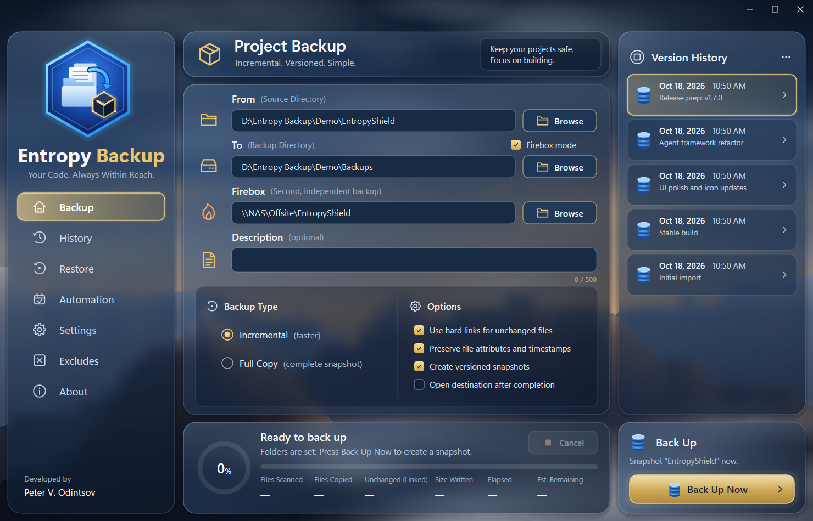
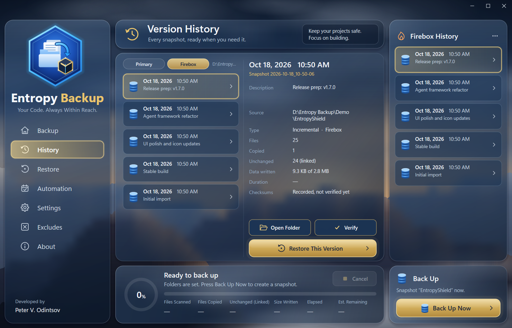
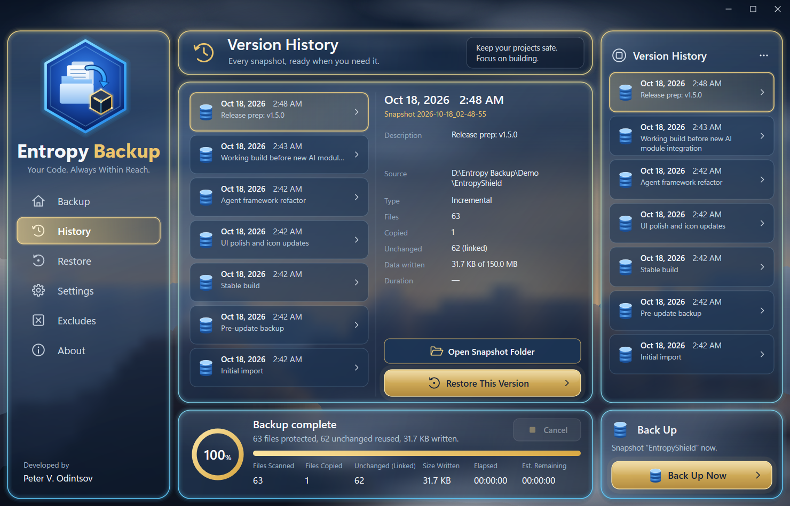
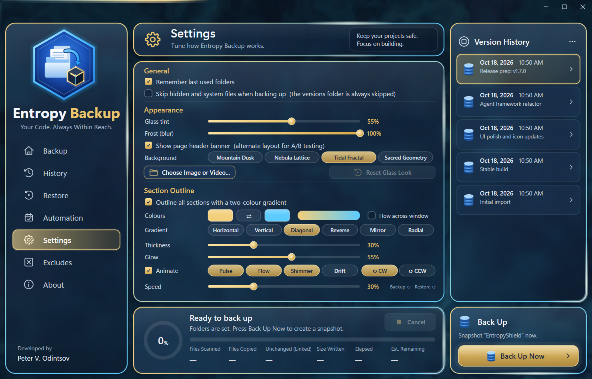

# Entropy Backup

**When Entropy is back UP, launch EntropyBackup!....exe** 🙃

Entropy Backup is a simple yet effective native app for incremental, versioned project backups on **Windows 11** and **macOS**, with a modern frosted-glass UI.



> ⚠️ **Use at your own risk.** Entropy Backup is provided "as is", without warranty of any kind. You are solely responsible for your data and for verifying your backups. The author is not liable for any data loss or damage. Read the full [Disclaimer](DISCLAIMER.md) before use.

## Features

**Firebox mode: no single point of failure** 🔥
- Even a RAID NAS is still *one* machine in *one* place. Turn on **Firebox mode** (on the Backup page, next to *To*) and every backup also goes to a **Firebox**: a second location such as another drive, a second NAS or an off-site share. The name comes from the fireproof boxes that backups used to be stored in, off site, in case the building burned down.
- The two copies are **independent**: each destination gets its own complete snapshot chain, read straight from your project and never copied from the other. Losing or corrupting either one does not affect the other.
- On Windows both are made from **one scan** (and one shadow copy, when that is on), so they capture the same moment and each file is hashed only once. The macOS app backs up to the primary first, then to the Firebox.
- If one destination can't be reached (an unplugged drive, an offline NAS), the other is **still saved**. The status panel shows it in red, `backup.log` records it, and scheduled or scripted runs exit with code 1.
- Version History and Restore have a **Primary | Firebox** switch, so if the primary is gone you can browse, verify and restore straight from the Firebox.
- The app warns you if the Firebox is on the same drive as the backup folder, because then it is not a real second copy.
- Scheduled backups, retention and the command line (`--firebox DIR`) all include the Firebox.



**Backups**
- **From → To → Description → Back Up Now.** That's the whole workflow. The Back Up Now button lives in the bottom-right panel on every page.
- **Incremental** or **Full Copy** snapshots. Every snapshot is a complete, browsable copy of your project.
- **Hard links for unchanged files**, so a new version costs almost no extra space on NTFS.
- A per-snapshot `manifest.tsv` detects unchanged files instantly, and `backup.json` stores the description, counts and duration.
- Snapshots are written to `incomplete_*` first and renamed only once they finish, so a failed or cancelled backup never leaves a half-finished snapshot.
- Live progress: ring and bar, current file, files scanned / copied / unchanged, size written, elapsed time, estimated time remaining, and **Cancel** at any time.
- Locked or unreadable files are skipped and listed instead of failing the whole run.
- Long paths (`\\?\`) are supported, and junction loops are avoided.

**Automation and integrity** (the Automation page)
- **Scheduled backups**: hourly, daily or weekly through Windows Task Scheduler, so they also run while the app is closed. Missed runs start as soon as possible, and the page shows the next and last run. The task points at the exe's current location, so save the schedule again if you move it.
- **Command line and silent mode** for scripts. See [Command line](#command-line).
- **Open and locked files** are copied from a Volume Shadow Copy when that option is on and the backup runs as administrator. Without administrator rights the backup still runs, reads the live files and reports a warning.
- **Retention**: keep the newest *N* snapshots and/or delete snapshots older than *N* days. The newest snapshot is always kept, and because unchanged files are hard links, removing a snapshot never touches the others.
- **SHA-256 checksums** for every file, recorded in the manifest. **Verify** any snapshot from Version History or the command line, or automatically after each backup. Verification reads the files from disk (not the cache) and writes the result to `verify.json`.
- Every finished backup, verification and prune is appended to `backup.log`. A lock file stops a scheduled run and the app from writing to the same destination at once, and leftovers of interrupted runs are cleaned up.

**Versions and restore**
- **Version History** panel and page with full details for every snapshot.
- **Restore** any version into a folder you choose, with an optional overwrite and a confirmation step.
- **Excludes** keep things like `node_modules`, `.vs` and `*.obj` out of snapshots. Wildcards, path patterns and `#` comments are supported.

**Make it yours**
- **Backgrounds:** the built-in mountain dusk, three built-in calm, looping fractal videos (**Nebula Lattice**, **Tidal Fractal**, **Sacred Geometry**), or your own image or video (`.mp4`, `.mov`, `.wmv`, ...). Videos play muted, the frosted glass blurs them live, and they pause while the window is minimized or a backup is running.
- **Glass tint** and **Frost (blur)** sliders that update live.
- **Section Outline**: a two-colour gradient around every section.
  - Colour pickers and a swap button.
  - Horizontal, Vertical, Diagonal, Reverse, Mirror and Radial styles.
  - Optional single gradient that flows across the whole window.
  - Thickness and glow sliders.
  - **Animated glow**: calm effects you can combine (**Pulse**, **Flow**, **Shimmer**, **Drift**) with a speed slider.
  - **Flow** is a comet of light circling the edge of the window that shows what the app is doing: **clockwise while backing up, counter-clockwise while restoring**, and your chosen direction otherwise.
- Optional **page header banner** layout, frameless window, per-monitor DPI, and a layout that scales with the window.

| History | Settings |
|---|---|
|  |  |

## Download

From the [latest release](https://github.com/EntropySystem/EntropyBackup/releases/latest):

- **Windows 10/11 x64:** `EntropyBackup.exe` (and `EntropyBackupCLI.exe` for scripts). No installer is needed.
- **macOS 14 or later** (including macOS 27, Apple silicon and Intel): `EntropyBackup-macOS.zip`. Unzip it and move *Entropy Backup* to Applications. See [macOS](#macos).

The Windows executables are **not code-signed yet**, so SmartScreen may warn. Code signing through [SignPath.io](https://about.signpath.io) has been applied for (see [Code signing policy](#code-signing-policy)), and releases will be signed once it is approved. The macOS app is not notarized yet, so macOS asks you to allow it once in System Settings › Privacy & Security › **Open Anyway**. You can also build from source (below). Every push is built and tested on GitHub Actions; the downloads of any run are under its *Artifacts*.

## macOS

The macOS app (in [`macos/`](macos)) is a native Swift/SwiftUI app with the same features and the same snapshot format, so a backup folder can be browsed by either app. It uses Liquid Glass on macOS 26 and later.

- **Copies** are APFS clones where possible (instant, no extra space on the same volume), and permissions, extended attributes and dates are preserved.
- **Scheduled backups** are a per-user launchd agent (`~/Library/LaunchAgents/com.entropysystem.entropybackup.scheduled.plist`). A run missed while the Mac slept starts when it wakes.
- **Full Disk Access:** to back up Documents, Desktop or external drives from a scheduled run, add *Entropy Backup* in System Settings › Privacy & Security › Full Disk Access (the Automation page has a button). Re-add it after installing a new build.
- **Open files:** macOS does not lock open files, so they are read as they are. Volume Shadow Copy is Windows-only.
- **Command line:** the app's executable takes the same commands as `EntropyBackupCLI.exe` (without `--vss`):

```sh
alias entropybackup="/Applications/Entropy Backup.app/Contents/MacOS/EntropyBackup"
entropybackup backup --from ~/Projects/MyApp --to /Volumes/Backup --verify --keep 30
entropybackup backup --from ~/Projects/MyApp --to /Volumes/Backup --firebox /Volumes/Offsite/MyApp
```

Build it with Xcode 15 or later: `cd macos && swift test && scripts/make-app.sh` (output in `macos/dist/`).

## Command line

`EntropyBackupCLI.exe` is the same program built for the console, so shells wait for it and get its exit code. `EntropyBackup.exe` accepts the same commands and runs them without a window, which is what the scheduled task uses.

```bat
EntropyBackupCLI backup --from "C:\Projects\MyApp" --to "E:\Backups" --desc "Nightly"
EntropyBackupCLI backup --from "C:\Projects\MyApp" --to "E:\Backups" --vss --verify --keep 30
EntropyBackupCLI backup --from "C:\Projects\MyApp" --to "E:\Backups" --firebox "\\NAS\Offsite\MyApp"
EntropyBackupCLI verify --to "E:\Backups"                       (newest snapshot)
EntropyBackupCLI verify 2026-10-18_01-32-05 --to "E:\Backups"
EntropyBackupCLI prune  --to "E:\Backups" --keep 30 --keep-days 90
EntropyBackupCLI list   --to "E:\Backups"
```

Options you don't pass come from the app's saved settings (backup type, excludes, checksums and so on). Run `EntropyBackupCLI help` for the full list.

| Exit code | Meaning |
|---|---|
| 0 | Success |
| 1 | Success with warnings (skipped files, checksum problems, shadow copy unavailable, one of the two Firebox-mode destinations not saved) |
| 2 | Failed |
| 3 | Invalid arguments |
| 4 | Cancelled (Ctrl+C) |

To schedule it with your own tooling instead of the Automation page:

```bat
schtasks /Create /TN "Nightly project backup" /SC DAILY /ST 02:00 /RL HIGHEST ^
  /TR "\"C:\Tools\EntropyBackup.exe\" backup --scheduled --from \"C:\Projects\MyApp\" --to \"E:\Backups\" --vss"
```

## Build from source (Windows)

Requirements: Visual Studio 2022 (or Build Tools) with **Desktop development with C++**, a Windows SDK, and CMake 3.24+.

```bat
build.cmd
```

or

```powershell
cmake -S . -B build -G "Visual Studio 17 2022" -A x64
cmake --build build --config Release
```

The output is `build\Release\EntropyBackup.exe` and `build\Release\EntropyBackupCLI.exe` (`build.cmd` also copies both to `dist\`).

## Snapshot format

```
<To>\EntropyBackup_Versions\
    snapshot_2026-10-18_01-32-05\
        files\          complete copy of the project (unchanged files are hard links)
        manifest.tsv    size, timestamp, SHA-256 (when enabled) and path of every file
        backup.json     description, source, type, counts, bytes, duration, skipped files
        verify.json     result of the last verification (if any)
    mirror_latest\      used instead when "Create versioned snapshots" is off
<Firebox>\EntropyBackup_Versions    snapshot_...\       the same layout; backup.json says "firebox": true
```

A snapshot's `files` folder is a plain copy of your project. You can always restore by hand by copying it anywhere.

Settings, excludes, `backup.log` and `runtime.log` are stored in `%APPDATA%\EntropyBackup`.

## Code signing policy

> **Status: pending.** Entropy Backup has applied to the SignPath Foundation open-source program. Until it is approved, the Windows executables are unsigned. The release build is already set up to sign them, and the first release after approval will be signed.

Free code signing provided by [SignPath.io](https://about.signpath.io), certificate by [SignPath Foundation](https://signpath.org).

- Signed files: `EntropyBackup.exe` and `EntropyBackupCLI.exe` in the [releases](https://github.com/EntropySystem/EntropyBackup/releases) of this repository.
- Every signed file is built from this repository's source by GitHub Actions ([`build.yml`](.github/workflows/build.yml)). Nothing built anywhere else is signed.
- Committers and reviewers: the [members of this repository](https://github.com/EntropySystem/EntropyBackup/graphs/contributors).
- Approver for each signing request: Peter V. Odintsov.

**Privacy policy:** this program will not transfer any information to other networked systems unless specifically requested by the user or the person installing or operating it. Entropy Backup only reads and writes the folders you choose; settings and logs stay on your computer.

## License and disclaimer

Released under the [MIT License](LICENSE). The Software is provided **"AS IS", without warranty of any kind**, and the authors are **not liable** for any claim, damages or other liability arising from its use. See [DISCLAIMER.md](DISCLAIMER.md) for the full terms. By using Entropy Backup you accept full responsibility for your data and its backups.

Developed by **Peter V. Odintsov**.
